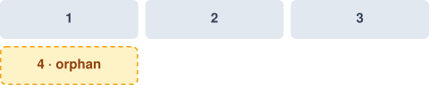
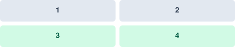

# `<smart-grid>` Web Component

<p>
  <a href="https://github.com/wazum/smart-grid/actions/workflows/ci.yml"></a>
  <a href="https://developer.mozilla.org/en-US/docs/Web/API/Web_components"></a>
  <a href="https://www.typescriptlang.org/"></a>
  <a href="package.json"></a>
  <a href="#license"></a>
</p>

**Smart CSS Grid layouts with auto-rebalancing for orphan rows.**

A zero-dependency web component that creates balanced grid layouts — no more lonely single items on the last row.

[**Live Demo**](https://wazum.github.io/smart-grid/) · [Layout cases](https://wazum.github.io/smart-grid/cases.html) (every layout rule, checked in the browser)

## The Problem

Traditional grids leave lonely orphans:



## The Solution

SmartGrid rebalances automatically:



## Installation

```bash
npm install @wazum/smart-grid
```

## Usage

With a bundler:

```js
import '@wazum/smart-grid'
import '@wazum/smart-grid/styles'
```

Or directly in the page:

```html
<script type="module" src="dist/smart-grid.js"></script>
<link rel="stylesheet" href="dist/smart-grid.css">

<smart-grid columns="3">
  <div>1</div>
  <div>2</div>
  <div>3</div>
  <div>4</div>
</smart-grid>
<!-- Result: 2x2 grid instead of 3+1 -->
```

### Semantic Sizing

Items can specify relative widths:

```html
<smart-grid columns="6">
  <div data-size="large">3 units</div>
  <div data-size="medium">2 units</div>
  <div data-size="small">1 unit</div>
</smart-grid>
```


## API

### Attributes

| Attribute   | Default       | Description                                  |
|-------------|---------------|----------------------------------------------|
| `columns`   | `3`           | Maximum columns (1–12)                       |
| `fill`      | `equal-extra` | How items fill rows: `equal-extra` or `none` |
| `fill-last` | inherits fill | Override fill behavior for last row only     |
| `align`     | `start`       | Where rows that do not fill go: `start`, `center` or `end` |

### Child Attributes

| Attribute   | Values                     | Default | Description              |
|-------------|----------------------------|---------|--------------------------|
| `data-size` | `small`, `medium`, `large` | `small` | Relative width (1, 2, 3) |

### Properties

| Property           | Type                               | Description                                       |
|--------------------|------------------------------------|---------------------------------------------------|
| `columns`          | `number`                           | Reflects the `columns` attribute                  |
| `fill`             | `'equal-extra' \| 'none'`           | Reflects the `fill` attribute                     |
| `fillLast`         | `'equal-extra' \| 'none'`           | Reflects the `fill-last` attribute                |
| `align`            | `'start' \| 'center' \| 'end'`       | Reflects the `align` attribute                    |
| `effectiveColumns` | `number` (read-only)               | Current column count after responsive adjustments |

```js
const grid = document.querySelector('smart-grid') // typed as SmartGrid
grid.columns = 4
grid.align = 'center'
```

Adding, removing or resizing children (`data-size`) relayouts automatically.

### Fill Modes

**`fill="equal-extra"`** (default): items expand to fill the row. 7 items in 3 columns:


**`fill="none"`**: items keep their width and leave a gap:



### Alignment

Rows that keep their item width (`fill="none"`, or the last row with `fill-last="none"`) are placed by `align`:

```html
<smart-grid columns="3" fill-last="none" align="center">…5 items…</smart-grid>
```


If stretching a short row exactly would need more grid tracks than fit the width (for example rows of 12 and 7 items with a gap), that row keeps its item width and follows `align` instead of overflowing.

### CSS Custom Properties

```css
smart-grid {
  --smart-grid-gap: 1rem;
  --smart-grid-min-width: 200px;        /* Responsive breakpoint */
  --smart-grid-min-width-medium: 400px; /* For medium items */
  --smart-grid-min-width-large: 600px;  /* For large items */
}
```

## License

MIT — Wolfgang Klinger <wolfgang@wazum.com>
